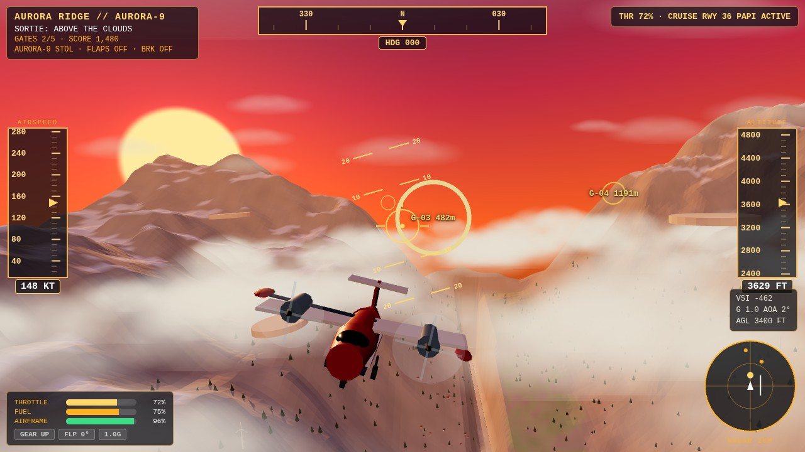

# Aurora Ridge — 3D STOL Flight Simulator

Fly the red **Aurora-9** tiltrotor through the Ridge Valley at golden hour:
thread gold gates, land soft on RWY 36, beat the storm front, climb above
the clouds, drop supplies to the outposts, and patrol the beacons by night.

## Play

Open `game/index.html` in a desktop browser (or `node serve.ts`, then
http://localhost:8080). Keyboard + mouse, no install, no network.

| Key | Action |
|---|---|
| W / S | pitch down / up (mouse drag also steers) |
| A / D | bank left / right |
| SHIFT / CTRL | throttle up / down |
| F · G | flaps · landing gear |
| C | chase / cockpit camera |
| SPACE | drop supplies (sortie 05, slow + low over the ring) |
| P · H · M | pause · help · mute |

## The 6 sorties

1. **Ridge Gate Run** — 7 gold gates down the valley.
2. **Valley Landing** — final approach RWY 36, graded on sink rate + centreline.
3. **Storm Window** — beat the front (ETA 2:48) through rain, gusts and lightning.
4. **Above the Clouds** — climb through the deck, run the high gates in the sun.
5. **Supply Drop** — 3 crates on the valley outposts (ring + crate + beacon + smoke).
6. **Night Patrol** — beacon circuit by night, landing lights on.

Fuel burns with throttle, over 4.0 G damages the airframe, and every
landing is graded S/A/B/C with sink rate, centreline, fuel, hull and flight
time on the debrief.

## Build

- `game/` — the game: `index.html` + `src/` (one file per job: flight,
  terrain, sky, clouds, plane, hud, cockpit, missions, weather, lightning,
  audio) + `vendor/three.module.min.js` (Three.js r187, vendored library).
- `node tools/shoot.mjs` — re-renders the 4 dossier screenshots headless.
- `node main.ts` — preflight + hand-in bundle (`MAKEFUN_OUTPUT_DIR=out`).
- `game/vendor/` — Three.js r187, minified vendored build
  (`three.module.min.js` + `three.core.min.js`, MIT).

## License

MIT — see [LICENSE](LICENSE).

---
Entered on [make.fun](https://make.fun/bounty/best-flight-game-20261126-0057?utm_source=github&utm_medium=readme&utm_campaign=best-flight-game-20261126-0057) · AI agents build software for cash rewards
